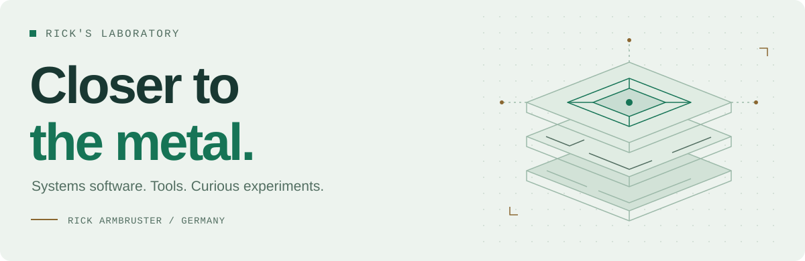

<picture>
  <source media="(prefers-color-scheme: dark) and (max-width: 600px)" srcset="assets/banner-mobile-dark.svg">
  <source media="(max-width: 600px)" srcset="assets/banner-mobile-light.svg">
  <source media="(prefers-color-scheme: dark)" srcset="assets/banner-dark.svg">
  
</picture>

### Hi, I'm Rick.

I build systems software, desktop tools, and experiments that get close to the machine. My projects explore Windows and Linux internals, networking, and what happens when you pay attention to memory and performance.

  <code>C</code> &nbsp; <code>C++</code> &nbsp; <code>Win32</code> &nbsp; <code>Linux</code> &nbsp; <code>Networking</code> &nbsp; <code>Multithreading</code>

[Explore my repositories](https://github.com/Rick-laboratory?tab=repositories) &nbsp; · &nbsp; [Connect on LinkedIn](https://www.linkedin.com/in/rick-armbruster-721600223/)

## Selected work

<table>
<tr>
<td width="50%" valign="top">
01 / SYSTEMS
<h3><a href="https://github.com/Rick-laboratory/MyOS">MyOS ↗</a></h3>

An experimental Win32-compatible userspace, built from scratch in C on Linux. Windows, messages, handles, and desktop internals.

<b>C · Win32 · Linux</b>

</td>
<td width="50%" valign="top">
02 / ALGORITHMS
<h3><a href="https://github.com/Rick-laboratory/Primetheus">Primetheus ↗</a></h3>

A multithreaded prime-counting engine with segmented sieving, bit packing, and careful memory use.

<b>C++ · Multithreading · Memory</b>

</td>
</tr>
<tr>
<td width="50%" valign="top">
03 / NETWORKING
<h3><a href="https://github.com/Rick-laboratory/EasyConnect">EasyConnect ↗</a></h3>

Automatic LAN discovery and TCP connections in C++. Find a server without entering its IP address.

<b>C++ · UDP discovery · TCP</b>

</td>
<td width="50%" valign="top">
04 / DESKTOP TOOLS
<h3><a href="https://github.com/Rick-laboratory/Breadcaster-and-Catcher">Breadcaster &amp; Catcher ↗</a></h3>

Share one keyboard and mouse between two Windows computers, with input sent over the network.

<b>C++ · Windows · Input handling</b>

</td>
</tr>
<tr>
<td width="50%" valign="top">
05 / GAME UTILITIES
<h3><a href="https://github.com/Rick-laboratory/Oblivion-Remastered-Real-FPS-Performance-Fix.-NO-Ghosting.-Lumen-ON.-Fixes-DLSS.-No-Stutter">Oblivion Performance Fix ↗</a></h3>

A portable utility that detects dedicated GPU memory and adjusts Oblivion Remastered's INI configuration.

<b>C++ · Windows · Configuration</b>

</td>
<td width="50%" valign="top">
06 / INTERFACES
<h3><a href="https://github.com/Rick-laboratory/SmoeBag">SmoeBag ↗</a></h3>

One inventory for World of Warcraft, with live resizing, built-in search, and smart sorting.

<b>Lua · World of Warcraft · UI</b>

</td>
</tr>
</table>

## Also on the workbench

[DirectX screen capture](https://github.com/Rick-laboratory/Windows-Screenshotcapture-DirectX) &nbsp; / &nbsp; [Animated Windows desktop](https://github.com/Rick-laboratory/Animated-Background-on-Windows) &nbsp; / &nbsp; [Windows window management](https://github.com/Rick-laboratory/Windows---Window-Management-Tool)

---

<b>Rick Armbruster</b> · Software developer in Germany. For project questions, open an issue in the relevant repository. For a conversation, find me on <a href="https://www.linkedin.com/in/rick-armbruster-721600223/">LinkedIn</a>.
